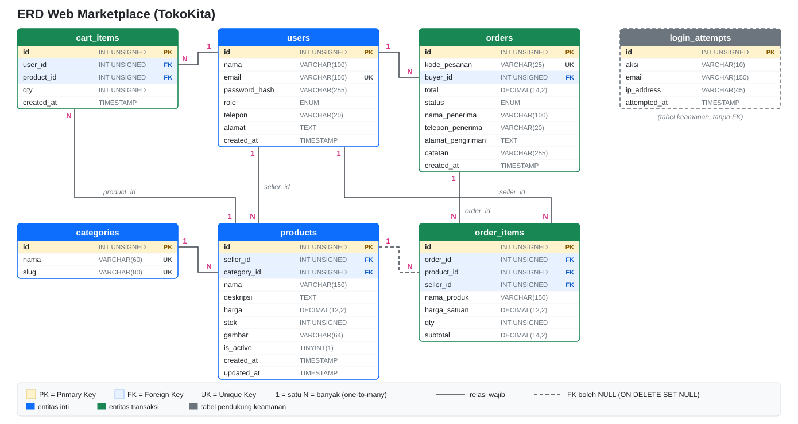
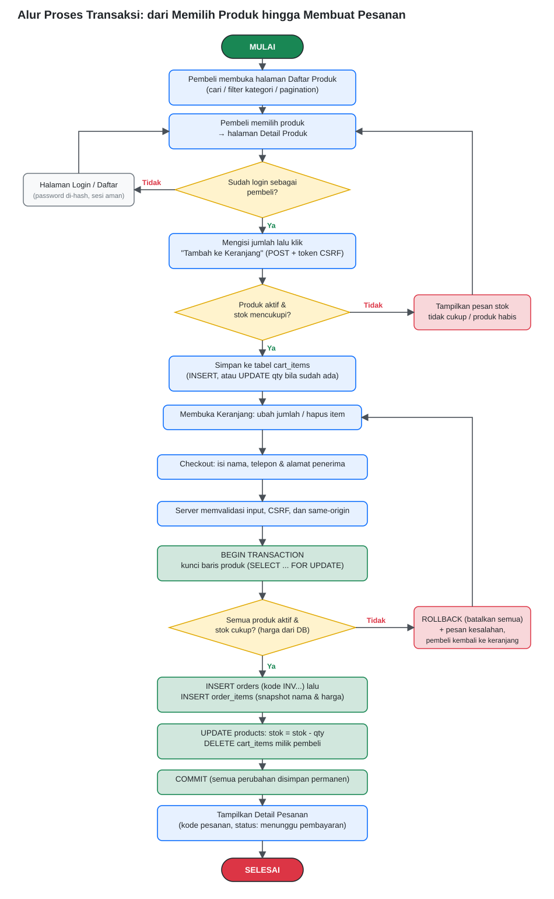
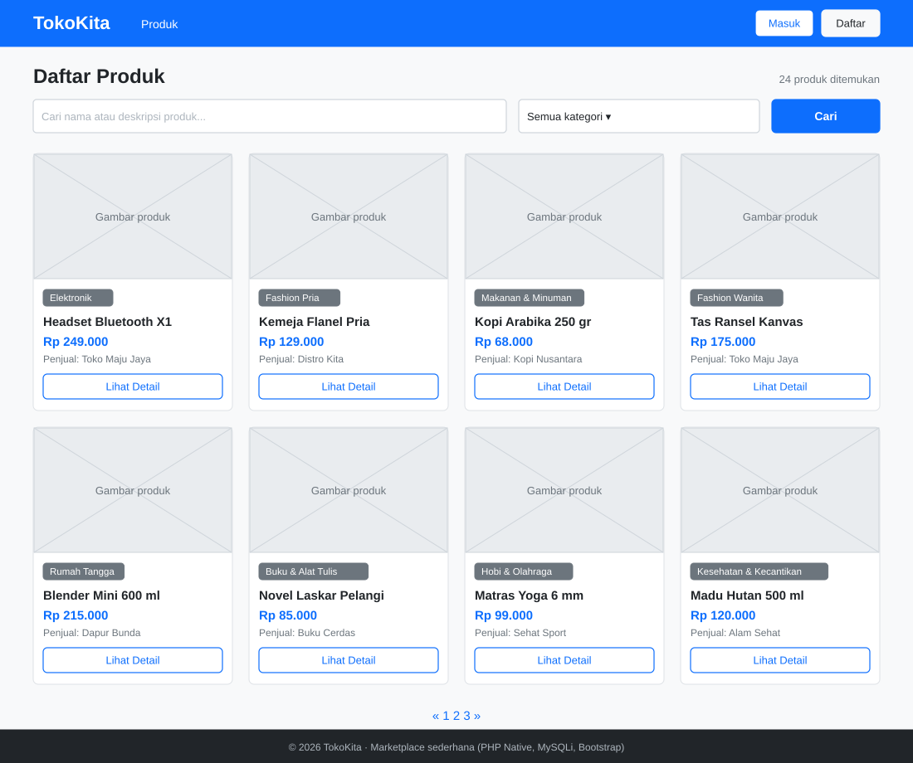
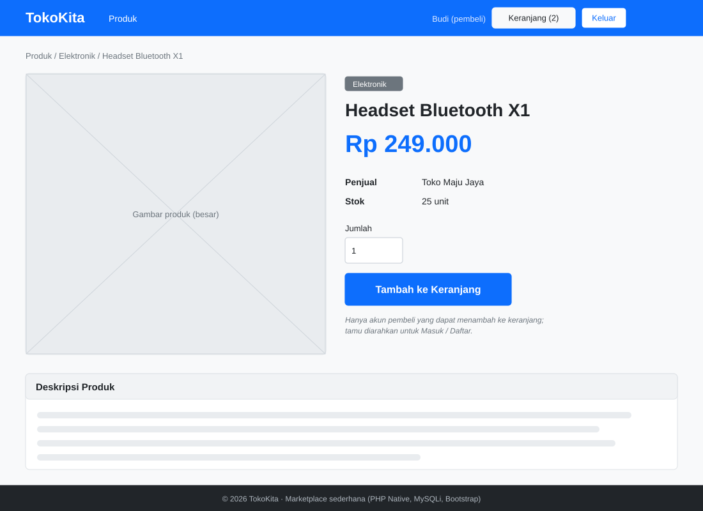
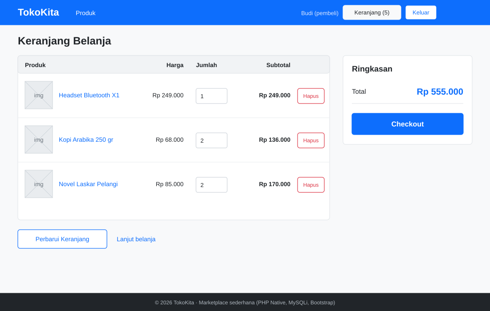

| Keterangan | Isi |
|---|---|
| Nama / NIM | (isi) |
| URL demo (InfinityFree) | (isi setelah deployment) |
| URL repository GitHub | (isi setelah upload) |

# A. Analisis dan Perancangan Sistem

## a. Identifikasi Entitas

Aplikasi marketplace sederhana ini melibatkan tiga jenis pengguna: **tamu** (belum login), **pembeli**, dan **penjual**. Dari kebutuhan tersebut diidentifikasi **7 entitas**:

| No | Entitas (tabel) | Deskripsi | Peran dalam sistem |
|---|---|---|---|
| 1 | `users` | Akun pengguna, berisi `role` pembeli atau penjual | Autentikasi & hak akses |
| 2 | `categories` | Kategori produk (Elektronik, Fashion, dll.) | Pengelompokan & filter produk |
| 3 | `products` | Produk yang ditawarkan penjual | Etalase, stok, harga |
| 4 | `cart_items` | Isi keranjang belanja per pembeli | Penampung sementara sebelum checkout |
| 5 | `orders` | Header transaksi pemesanan (kode, total, status, data penerima) | Transaksi |
| 6 | `order_items` | Rincian barang pada pesanan (snapshot nama & harga) | Detail transaksi |
| 7 | `login_attempts` | Catatan percobaan masuk/daftar | Anti brute-force (keamanan) |

**Kebutuhan fungsional utama:** menampilkan daftar & detail produk, mengelola produk (CRUD) oleh penjual, menambahkan produk ke keranjang, serta membuat dan menyimpan transaksi pemesanan ke database.

## b. Rancangan Database Relasional

Database: `marketplace` (MySQL/MariaDB, engine InnoDB, charset utf8mb4). Rancangan memenuhi bentuk normal ketiga (3NF); satu-satunya denormalisasi yang disengaja adalah *snapshot* `nama_produk` dan `harga_satuan` pada `order_items` agar riwayat pesanan tetap benar walau produk berubah atau dihapus.

### Tabel `users`
| Atribut | Tipe | Key | Keterangan |
|---|---|---|---|
| id | INT UNSIGNED AUTO_INCREMENT | **PK** | |
| nama | VARCHAR(100) | | |
| email | VARCHAR(150) | UNIQUE | login |
| password_hash | VARCHAR(255) | | hasil `password_hash()` (bcrypt) |
| role | ENUM('pembeli','penjual') | | hak akses |
| telepon | VARCHAR(20) | | opsional |
| alamat | TEXT | | opsional |
| created_at | TIMESTAMP | | |

### Tabel `categories`
| Atribut | Tipe | Key | Keterangan |
|---|---|---|---|
| id | INT UNSIGNED AUTO_INCREMENT | **PK** | |
| nama | VARCHAR(60) | UNIQUE | |
| slug | VARCHAR(80) | UNIQUE | |

### Tabel `products`
| Atribut | Tipe | Key | Keterangan |
|---|---|---|---|
| id | INT UNSIGNED AUTO_INCREMENT | **PK** | |
| seller_id | INT UNSIGNED | **FK** → users.id | pemilik produk |
| category_id | INT UNSIGNED | **FK** → categories.id | |
| nama | VARCHAR(150) | | |
| deskripsi | TEXT | | |
| harga | DECIMAL(12,2) | | CHECK harga ≥ 0 |
| stok | INT UNSIGNED | | |
| gambar | VARCHAR(64) | | nama file acak hasil unggah |
| is_active | TINYINT(1) | | 1 = tampil di etalase |
| created_at, updated_at | TIMESTAMP | | |

### Tabel `cart_items`
| Atribut | Tipe | Key | Keterangan |
|---|---|---|---|
| id | INT UNSIGNED AUTO_INCREMENT | **PK** | |
| user_id | INT UNSIGNED | **FK** → users.id | |
| product_id | INT UNSIGNED | **FK** → products.id | |
| qty | INT UNSIGNED | | CHECK qty ≥ 1 |
| created_at | TIMESTAMP | | |

Kendala tambahan: `UNIQUE (user_id, product_id)` — satu baris per produk per pembeli.

### Tabel `orders`
| Atribut | Tipe | Key | Keterangan |
|---|---|---|---|
| id | INT UNSIGNED AUTO_INCREMENT | **PK** | |
| kode_pesanan | VARCHAR(25) | UNIQUE | format `INVYYYYMMDDXXXXXX` |
| buyer_id | INT UNSIGNED | **FK** → users.id | |
| total | DECIMAL(14,2) | | dihitung server |
| status | ENUM | | menunggu_pembayaran, diproses, dikirim, selesai, dibatalkan |
| nama_penerima | VARCHAR(100) | | |
| telepon_penerima | VARCHAR(20) | | |
| alamat_pengiriman | TEXT | | |
| catatan | VARCHAR(255) | | opsional |
| created_at | TIMESTAMP | | |

### Tabel `order_items`
| Atribut | Tipe | Key | Keterangan |
|---|---|---|---|
| id | INT UNSIGNED AUTO_INCREMENT | **PK** | |
| order_id | INT UNSIGNED | **FK** → orders.id | |
| product_id | INT UNSIGNED NULL | **FK** → products.id | boleh NULL bila produk dihapus |
| seller_id | INT UNSIGNED | **FK** → users.id | penjual produk saat dipesan |
| nama_produk | VARCHAR(150) | | snapshot |
| harga_satuan | DECIMAL(12,2) | | snapshot |
| qty | INT UNSIGNED | | CHECK qty ≥ 1 |
| subtotal | DECIMAL(14,2) | | |

### Tabel `login_attempts` (keamanan)
| Atribut | Tipe | Key | Keterangan |
|---|---|---|---|
| id | INT UNSIGNED AUTO_INCREMENT | **PK** | |
| aksi | VARCHAR(10) | | `login` atau `register` |
| email | VARCHAR(150) | | |
| ip_address | VARCHAR(45) | | |
| attempted_at | TIMESTAMP | | |

### Hubungan antar-tabel

| Relasi | Kardinalitas | Foreign key | Aturan hapus |
|---|---|---|---|
| users – products | 1 : N | products.seller_id | CASCADE |
| categories – products | 1 : N | products.category_id | RESTRICT |
| users – cart_items | 1 : N | cart_items.user_id | CASCADE |
| products – cart_items | 1 : N | cart_items.product_id | CASCADE |
| users – orders | 1 : N | orders.buyer_id | RESTRICT |
| orders – order_items | 1 : N | order_items.order_id | CASCADE |
| products – order_items | 1 : N (opsional) | order_items.product_id | SET NULL |
| users – order_items | 1 : N | order_items.seller_id | RESTRICT |

Skrip pembuatan lengkap: `database/schema.sql`.

## c. ERD (Entity Relationship Diagram)



## d. Alur Proses Transaksi



**Langkah proses:**

1. Pembeli membuka **Daftar Produk** (`index.php`), dapat mencari dan memfilter kategori.
2. Pembeli memilih produk dan masuk ke **Detail Produk** (`produk.php`).
3. Jika belum login sebagai pembeli, diarahkan ke Login/Daftar; setelah itu kembali memilih produk.
4. Pembeli mengisi jumlah dan menekan **Tambah ke Keranjang** (POST dengan token CSRF).
5. Server memeriksa produk aktif dan stok mencukupi. Jika tidak, pesan kesalahan ditampilkan; jika ya, data disimpan ke `cart_items`.
6. Pembeli membuka **Keranjang** (`cart.php`) untuk mengubah jumlah atau menghapus item.
7. Pembeli membuka **Checkout** (`checkout.php`) dan mengisi nama, telepon, dan alamat penerima.
8. Server memvalidasi input, token CSRF, dan asal permintaan (same-origin).
9. Server memulai **transaksi database** (`BEGIN`) dan mengunci baris produk dengan `SELECT ... FOR UPDATE`.
10. Server memverifikasi ulang status dan stok setiap produk, serta mengambil harga **dari database** (bukan dari input pengguna). Jika ada yang tidak valid → `ROLLBACK` dan pembeli kembali ke keranjang dengan pesan kesalahan.
11. Jika valid: `INSERT` ke `orders` dan `order_items`, kurangi stok (`UPDATE products SET stok = stok - qty WHERE stok >= qty`), kosongkan `cart_items`, lalu `COMMIT`.
12. Pembeli diarahkan ke **Detail Pesanan** (`order_detail.php`) dengan status *menunggu pembayaran*.

## e. Rancangan Antarmuka (Mockup UI)

### 1) Halaman Daftar Produk (`index.php`)


### 2) Halaman Detail Produk (`produk.php`)


### 3) Halaman Keranjang Belanja (`cart.php`)


# B. Implementasi Aplikasi

## f. Teknologi dan Struktur Proyek

PHP Native 8.x, MySQLi (prepared statement), Bootstrap 5.3 (CDN dengan SRI), MySQL/MariaDB.

```
marketplace/
├── index.php            # Daftar produk (cari, filter, pagination)
├── produk.php           # Detail produk + tambah ke keranjang
├── cart.php             # Keranjang (tambah/ubah/hapus)
├── checkout.php         # Buat pesanan (transaksi database)
├── orders.php           # Riwayat pesanan pembeli
├── order_detail.php     # Detail & pembatalan pesanan
├── login.php  register.php  logout.php
├── seller/
│   ├── products.php     # CRUD - daftar produk penjual
│   ├── product_form.php # CRUD - tambah & edit (+ unggah gambar)
│   ├── product_delete.php  # CRUD - hapus
│   └── orders.php       # Pesanan masuk untuk penjual
├── includes/            # bootstrap, helpers, database, security, auth, layout, orders
├── config/              # config.sample.php (config.php TIDAK di Git)
├── database/schema.sql
├── assets/              # css, js, img
├── uploads/products/    # gambar produk (skrip tidak dieksekusi)
├── storage/logs/        # log error & keamanan
└── docs/                # dokumen perancangan, ERD, mockup
```

## g. Fitur Aplikasi

| Fitur | Pengguna | Berkas |
|---|---|---|
| Menampilkan daftar produk (cari, filter kategori, pagination) | Semua | `index.php` |
| Menampilkan detail produk | Semua | `produk.php` |
| Registrasi & login | Tamu | `register.php`, `login.php` |
| Mengelola produk (Create, Read, Update, Delete) + unggah gambar | Penjual | `seller/products.php`, `seller/product_form.php`, `seller/product_delete.php` |
| Menambahkan produk ke keranjang, ubah jumlah, hapus item | Pembeli | `cart.php` |
| Membuat & menyimpan transaksi pemesanan ke database | Pembeli | `checkout.php`, `includes/orders.php` |
| Riwayat, detail, dan pembatalan pesanan | Pembeli | `orders.php`, `order_detail.php` |
| Melihat pesanan masuk untuk produknya | Penjual | `seller/orders.php` |

**Hak akses (RBAC):**

| Halaman / aksi | Tamu | Pembeli | Penjual |
|---|:-:|:-:|:-:|
| Lihat produk & detail | ✔ | ✔ | ✔ |
| Keranjang, checkout, pesanan saya | ✘ | ✔ | ✘ |
| CRUD produk, pesanan masuk | ✘ | ✘ | ✔ (milik sendiri) |

# Protokol Keamanan Standar Profesional

Penerapan mengacu pada **OWASP Top 10** dan praktik OWASP ASVS.

| Risiko / standar | Penerapan | Lokasi |
|---|---|---|
| SQL Injection | Semua query memakai *prepared statement* MySQLi; wildcard `LIKE` di-escape; ID di-cast ke integer | `includes/database.php` |
| XSS | Semua keluaran di-escape `htmlspecialchars` (fungsi `e()`); tanpa *inline script*; CSP membatasi sumber skrip | `includes/helpers.php`, `includes/security.php` |
| CSRF | Token acak 256-bit per sesi, dicek `hash_equals` untuk **semua POST** secara global; verifikasi Origin/Referer; cookie SameSite=Lax; logout lewat POST | `includes/security.php`, `includes/bootstrap.php` |
| Penyimpanan password | `password_hash` bcrypt cost 12, rehash otomatis; kebijakan minimal 10 karakter, huruf + angka | `register.php`, `login.php` |
| Brute-force & enumerasi akun | Throttle (5 gagal/email dan 30/IP per 15 menit; pendaftaran dibatasi per IP); pesan galat generik; hash palsu agar waktu respons seragam | `includes/security.php`, `login.php` |
| Manajemen sesi | Cookie HttpOnly + Secure (saat HTTPS) + SameSite; *strict mode*; ID sesi diganti saat login (anti *session fixation*); idle timeout 30 menit, masa maksimum 8 jam; sesi dikaitkan dengan user-agent; sesi dihancurkan saat logout | `includes/security.php`, `includes/auth.php` |
| Broken Access Control / IDOR | RBAC (`require_role`); kepemilikan diperiksa di query (`seller_id`, `buyer_id`); sumber milik orang lain tampil 404 | `includes/auth.php`, `seller/*`, `order_detail.php` |
| Integritas transaksi | Harga & stok selalu dari DB; transaksi ACID; `SELECT ... FOR UPDATE`; `UPDATE ... AND stok >= qty`; *rollback* bila gagal | `includes/orders.php` |
| Unggah file | Cek MIME asli (`finfo`), ukuran, dimensi; **re-encode GD** (membuang metadata & payload tersembunyi); nama file acak; folder `uploads/` tidak mengeksekusi skrip; hapus file lewat validasi nama (anti *path traversal*) | `includes/security.php`, `uploads/.htaccess` |
| Header keamanan | CSP, X-Frame-Options DENY, X-Content-Type-Options, Referrer-Policy, Permissions-Policy, COOP/CORP, HSTS (saat HTTPS), Cache-Control no-store | `includes/security.php` |
| Misconfiguration | `display_errors` off & galat ke log; `.htaccess` memblokir `config/`, `includes/`, `database/`, `storage/`, `docs/`; *directory listing* mati; penjaga `APP_BOOT` | `.htaccess`, `includes/*.php` |
| Rahasia & kredensial | `config/config.php` di luar Git (`.gitignore`); hanya `config.sample.php` yang di-commit; tidak ada akun/password bawaan | `.gitignore`, `config/` |
| Transport | Opsi `force_https`, `upgrade-insecure-requests`, HSTS | `includes/bootstrap.php` |
| Integritas pustaka pihak ketiga | Subresource Integrity (SRI) pada Bootstrap CDN | `includes/layout.php` |
| Logging | Kejadian keamanan (`csrf_invalid`, `origin_mismatch`, `login_failed`, `login_locked`) dicatat tanpa data pribadi (email di-hash) | `storage/logs/` |
| Open redirect | Redirect hanya ke path internal aplikasi | `includes/helpers.php` |

**Keterbatasan yang perlu diketahui:** belum ada verifikasi email, autentikasi dua faktor, atau CAPTCHA; pembatasan per-IP bergantung pada `REMOTE_ADDR` sehingga kurang akurat bila banyak pengguna berbagi satu IP/proxy; status pesanan setelah dibuat hanya dapat diubah pembeli (batal), belum ada alur pembayaran/pengiriman.

# Panduan Menjalankan

**Lokal (XAMPP):**

1. Salin folder proyek ke `htdocs/marketplace`, jalankan Apache dan MySQL.
2. Buat database `marketplace` di phpMyAdmin, lalu *Import* `database/schema.sql`.
3. Salin `config/config.sample.php` menjadi `config/config.php`, sesuaikan kredensial (default XAMPP: user `root`, password kosong).
4. Buka `http://localhost/marketplace/`, daftar satu akun **penjual** dan satu akun **pembeli**.

**Deployment & GitHub** dikerjakan manual (lihat `README.md`): unggah ke InfinityFree, buat `config/config.php` langsung di server, dan **jangan** meng-commit `config.php`.

# Rencana Pengujian Transaksi

| ID | Skenario | Hasil yang diharapkan |
|---|---|---|
| T01 | Daftar akun penjual dan pembeli | Akun tersimpan; password di database berupa hash |
| T02 | Penjual menambah, mengubah, menghapus produk + unggah gambar | Data produk berubah sesuai; gambar tampil |
| T03 | Pembeli menambah produk ke keranjang | Baris baru di `cart_items`; badge keranjang bertambah |
| T04 | Menambah jumlah melebihi stok | Ditolak dengan pesan stok |
| T05 | Checkout dengan data valid | Baris di `orders` dan `order_items`, stok berkurang, `cart_items` kosong |
| T06 | Dua pembeli membeli stok terakhir hampir bersamaan | Hanya satu pesanan berhasil, stok tidak negatif |
| T07 | Pembeli membatalkan pesanan | Status `dibatalkan`, stok kembali |
| T08 | Pembeli membuka `/seller/products.php` | Ditolak 403 |
| T09 | Mengubah `id` di `order_detail.php` ke pesanan pembeli lain | 404 (tidak bocor) |
| T10 | Mengirim POST tanpa token CSRF | Ditolak 419 |
| T11 | Login salah 5 kali berturut-turut | Akun dikunci sementara |
| T12 | Memasukkan `' OR 1=1 --` pada pencarian dan login | Diperlakukan sebagai teks biasa |
| T13 | Nama produk berisi `<script>alert(1)</script>` | Tampil sebagai teks, tidak dieksekusi |

**Query untuk bukti pengujian di phpMyAdmin** (untuk tangkapan layar struktur database dan hasil transaksi):

```sql
SHOW TABLES;
DESCRIBE products;

SELECT o.kode_pesanan, u.nama AS pembeli, o.total, o.status, o.created_at
FROM orders o JOIN users u ON u.id = o.buyer_id ORDER BY o.id DESC;

SELECT order_id, nama_produk, harga_satuan, qty, subtotal
FROM order_items ORDER BY id DESC;

SELECT id, nama, stok FROM products;   -- stok harus berkurang sesuai pesanan
```

# Lampiran: Checklist Pengumpulan

- [x] Dokumen perancangan (dokumen ini)
- [x] ERD (`docs/erd.png`, `docs/erd.svg`)
- [x] Mockup UI (`docs/mockup/`)
- [x] Source code (folder proyek)
- [ ] URL demo InfinityFree — dikerjakan manual
- [ ] URL repository GitHub — dikerjakan manual
- [ ] Tangkapan layar aplikasi berjalan, struktur database, dan hasil pengujian transaksi — dikerjakan manual
